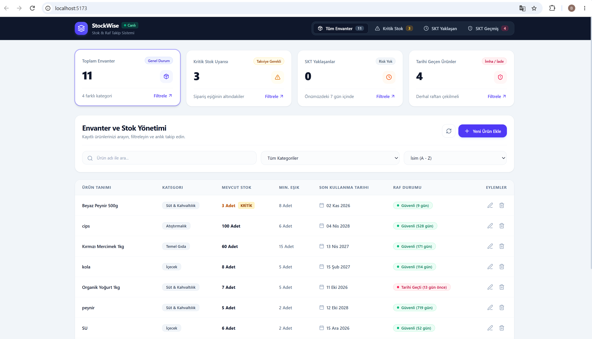

# StockWise

StockWise, ürün stoklarını ve son kullanma tarihlerini takip etmek için geliştirilmiş bir stok yönetimi uygulamasıdır.

## Özellikler

- Ürün ekleme, listeleme, güncelleme ve silme
- Kategori yönetimi
- Stok miktarlarını takip etme
- Düşük stok uyarıları
- Son kullanma tarihi yaklaşan ürünleri görüntüleme
- Son kullanma tarihi geçmiş ürünleri görüntüleme
- Ürün arama, filtreleme ve sıralama
- Özet bilgileri içeren kontrol paneli

## Kullanılan Teknolojiler

### Frontend
- React
- Vite
- JavaScript
- CSS

### Backend
- C#
- ASP.NET Core Web API
- Entity Framework Core

### Veritabanı
- Microsoft SQL Server

### Diğer Araçlar
- Git
- GitHub
- Docker

## Proje Yapısı

```text
StockWise/
├── backend/
│   ├── StockWise.API/
│   ├── StockWise.Business/
│   ├── StockWise.Core/
│   ├── StockWise.Data/
│   ├── StockWise.slnx
│   └── Dockerfile
├── docs/
│   └── stockwise-dashboard.png
└── frontend/
    ├── src/
    │   ├── components/
    │   ├── services/
    │   ├── App.jsx
    │   └── main.jsx
    ├── package.json
    └── vite.config.js
```

## Gereksinimler

Projeyi bilgisayarında çalıştırmak için aşağıdaki araçların kurulu olması gerekir:

- Node.js ve npm
- .NET SDK
- Microsoft SQL Server
- Git

## Kurulum

### 1. Projeyi Klonlama

```bash
git clone https://github.com/batuhanaydin1/StockWise.git
cd StockWise
```

### 2. Veritabanı Bağlantısı

`backend/StockWise.API/appsettings.json` dosyasındaki `DefaultConnection` bağlantı ayarını kendi SQL Server ortamına göre düzenle.

### 3. Backend'i Çalıştırma

Terminalde proje klasörünün kök dizinindeyken:

```bash
cd backend
dotnet restore StockWise.slnx
dotnet build StockWise.slnx
dotnet run --project StockWise.API/StockWise.API.csproj
```

Backend, yapılandırmaya göre `http://localhost:5013` veya `https://localhost:7154` adresinde çalışır.

### 4. Frontend'i Çalıştırma

Yeni bir terminal aç:

```bash
cd frontend
npm install
npm run dev
```

Frontend genellikle `http://localhost:5173` adresinde açılır.

API adresi, `frontend/src/services/api.js` dosyasındaki varsayılan ayardan veya `VITE_API_URL` ortam değişkeninden yapılandırılabilir.

## Docker

Backend için Dockerfile, `backend` klasöründe bulunur.

Projenin kök dizininden:

```bash
cd backend
docker build -t stockwise-api .
```

Bu komut backend için Docker imajını oluşturur. Konteyneri çalıştırırken veritabanı bağlantısını ve gerekli ortam değişkenlerini kendi ortamına göre yapılandırmalısın.

## Ekran Görüntüleri

### Kontrol Paneli



## Geliştirme Amaçları

Bu proje; React ile kullanıcı arayüzü geliştirme, ASP.NET Core Web API ile backend oluşturma, Entity Framework Core kullanımı, SQL Server entegrasyonu ve Git ile sürüm kontrolü konularında pratik yapmak amacıyla geliştirilmiştir.

## GitHub

Proje deposu: [StockWise](https://github.com/batuhanaydin1/StockWise)
